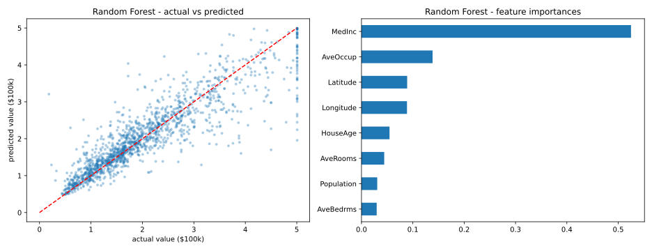

# California Housing Price Prediction

A practice project from my machine learning course. It predicts the
median house value of a California district from census attributes, and
includes a Streamlit web app for interactive predictions.

## Dataset

California housing dataset (20,640 districts, 1990 census, shipped with
scikit-learn). Target: median house value in $100,000s. Generated automatically from scikit-learn on first run if missing (and included in the offline copy).

## Project structure

- `train.py` - model comparison (linear regression vs random forest),
  evaluation, plots.
- `app.py` - Streamlit app: set district attributes with sliders, get a
  predicted value.
- `results.svg` - actual-vs-predicted scatter and feature importances.
- `housing.csv` - the dataset.

## How to run

```bash
pip install -r requirements.txt
python train.py        # model comparison + plots
streamlit run app.py   # web app on http://localhost:8501
```

## Results (test split = 20%, random_state=42)

| Model             | Test R2 | Test RMSE | Test MAE | 3-fold CV R2 |
|-------------------|---------|-----------|----------|--------------|
| Linear Regression | 0.576   | 0.746     | 0.533    | 0.604        |
| Random Forest     | 0.805   | 0.505     | 0.328    | 0.806        |

(Values are in $100,000s, so RMSE 0.505 = about $50,500.)



## Honest notes

- Practice project on 1990 census data - predictions reflect 1990 price
  levels, not today's market.
- The random forest clearly beats linear regression here because the
  relationships are non-linear; the linear baseline is kept for comparison.
